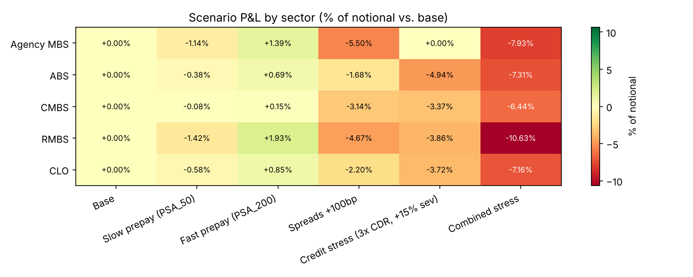

# Securitized Products Analytics — Prepayment, Credit & Scenario Modeling


A Python cash-flow engine for a portfolio of securitized tranches (Agency MBS, RMBS, CMBS, ABS, CLO). It projects monthly cash flows with **prepayments** and **defaults**, prices each bond off a benchmark-plus-spread curve, computes **WAL** and **effective duration**, and revalues the portfolio under prepayment, spread and credit stress scenarios.

All data is synthetic.



## The model

For each tranche, every month:

1. **Defaults** take a slice of the balance at the monthly default rate (MDR, from annual CDR). Defaults produce a **loss** (× severity) and a **recovery** (the rest).
2. The performing balance pays **interest** and **scheduled principal** on a level-payment schedule.
3. **Prepayments** retire a further share at the single monthly mortality (SMM, from annual CPR).
4. Cash flows are discounted at benchmark + spread to get **price per 100**. WAL and effective duration (±25bp) follow from the same cash flows.

| Scenario | Shock |
|---|---|
| Slow / fast prepay | CPR × 0.5 / × 2.0 (PSA-style multipliers from `data/prepayment_rates.csv`) |
| Spreads +100bp | Discount spread widened 100bp |
| Credit stress | CDR × 3, loss severity +15 pts (non-agency only) |
| Combined | Slow prepay + credit stress + spreads +100bp |

**Simplification:** each tranche is modeled on its own collateral cash flows, without a deal waterfall or subordination. That keeps the focus on how assumptions move value.

## Results (sample portfolio, 40 tranches)

| Scenario | P&L vs. base | Avg. WAL | Avg. duration |
|---|---|---|---|
| Base | 0.00% | 5.05 yrs | 3.93 |
| Slow prepay | −0.78% | 6.22 yrs | 4.66 |
| Fast prepay | +1.07% | 3.60 yrs | 2.97 |
| Spreads +100bp | −3.58% | 5.05 yrs | 3.80 |
| Credit stress | −2.96% | 4.87 yrs | 3.81 |
| Combined stress | −7.97% | 6.00 yrs | 4.34 |

What the numbers show:

- **Spread risk is concentrated in long-duration paper.** Agency MBS and RMBS lose the most when spreads widen.
- **Agency MBS carry no credit-loss assumption**, so they are flat in the credit scenario; consumer ABS and lower-rated tranches take the hit.
- **Slower prepayments extend WAL and duration** (extension risk) and, with most bonds below par, also cost value.
- **The combined shock compounds**: more balance stays outstanding to absorb both higher defaults and wider spreads.

## Quick start

```bash
git clone https://github.com/RTorres1980/SecuritizedProductsAnalytics.git
cd SecuritizedProductsAnalytics
pip install -r requirements.txt

python scripts/run_model.py                 # scenarios -> dashboard/exports/
python scripts/generate_dashboard_data.py   # Power BI-ready metrics + chart
python scripts/generate_sample_data.py      # optional: regenerate the portfolio (--n, --seed)
```

## Notebooks

| Notebook | Covers |
|---|---|
| `01_Portfolio_Overview` | Data-quality checks, composition, spread-by-rating consistency |
| `02_Cashflow_Modeling` | One tranche end to end: cash-flow table, price/WAL/duration, CPR sensitivity |
| `03_Risk_StressTesting` | Portfolio scenarios, sector P&L attribution, most exposed bonds |

The notebooks are committed with their outputs, so they can be read directly on GitHub.

## Power BI

`dashboard/exports/` holds the CSVs for a Power BI dashboard. See [docs/POWERBI_INSTRUCTIONS.md](docs/POWERBI_INSTRUCTIONS.md) for the data model, suggested pages and a DAX measure.

## Tests

```bash
pytest -q
```

Checks rate conversions, that principal plus losses always equals the starting balance, that a bond priced at its own coupon rate returns par, that faster prepayment shortens WAL, and that each scenario moves P&L in the expected direction.

## Author

Robert Torres · [LinkedIn](https://www.linkedin.com/in/robert-torres-394535381) · [GitHub](https://github.com/RTorres1980)
